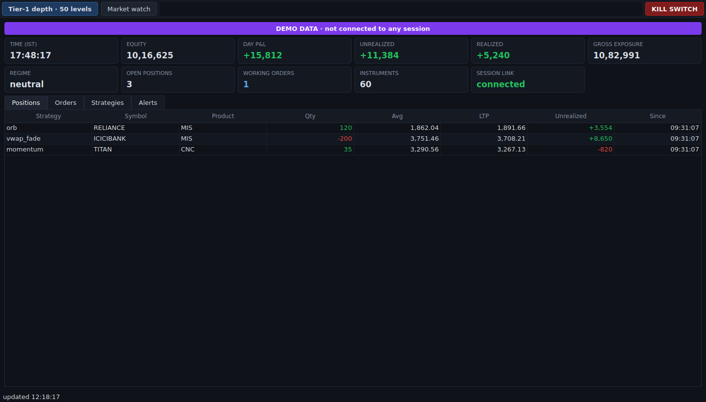
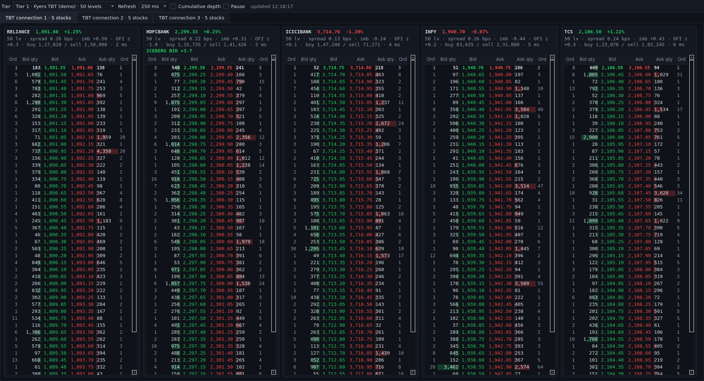
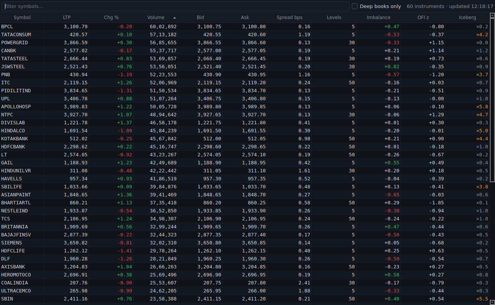
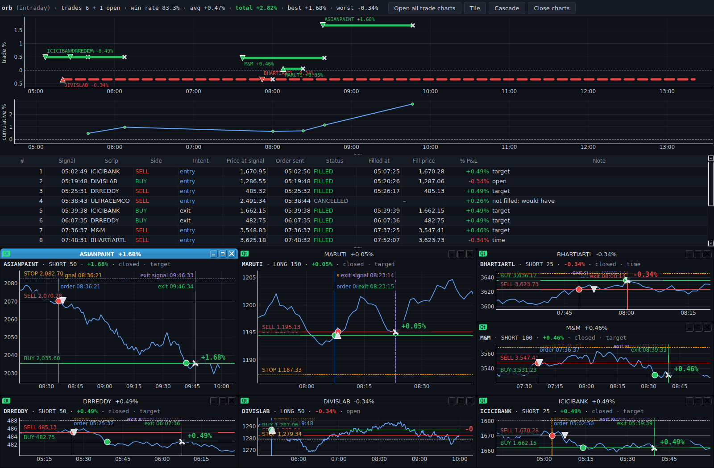
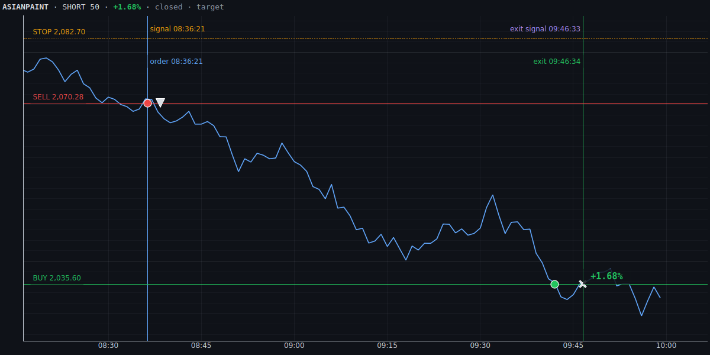
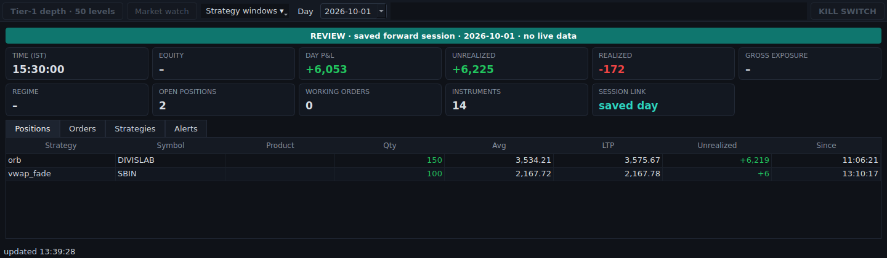

> **Monorepo Path Architecture (`NSE_ROOT`)**: This repository uses a mirrored `code/` and `data/` directory structure rooted at the **`NSE_ROOT`** environment variable. All source code resides under `$NSE_ROOT/code/<ENGINE>` and all runtime artifacts (logs, SQLite/DuckDB databases, Parquet datasets, trained ML models, and generated reports) reside in the mirrored `$NSE_ROOT/data/<ENGINE>` directory.

# Desk guide

Start the desk with `nsealgo desk`, which watches a forward test. Use `--mode live` for live trading, `--review` for saved days, or `--demo` for synthetic data.

## Main window

- **Banner:** LIVE (red), FORWARD (blue), DEMO (purple), REVIEW (teal). It turns red with "KILL SWITCH SET" when trading is stopped.
- **Cards:** time, equity, day P&L, unrealized and realized P&L, exposure, regime, open positions, working orders, instruments, and the session link.
- **Tabs:** Positions, Orders, Strategies (double-click a row for its strategy window), Alerts (warnings and errors).
- **Buttons:**
  - **Tier-1 depth · 50 levels:** opens the depth window.
  - **Market watch:** opens the watch list.
  - **Strategy windows ▾:** opens a window per strategy.
  - **KILL SWITCH:** asks first.

## Tier-1 depth

One tab per Fyers TBT connection (5 stocks each), each stock in its own ladder.
- **Ladder columns:** orders · bid quantity · bid | ask · ask quantity · orders. Bars are proportional to quantity; tick **Cumulative depth** for running totals.
- **Header line:** levels, spread, imbalance (−1 sell-heavy … +1 buy-heavy), order-flow z-score, total buy/sell quantity, and data age in ms.
- **Flags:** **ICEBERG ASK / BID** (hidden size holding a level) and **STALE** (no update for over 2 s).
- **Toolbar:** pick another tier (e.g. Upstox 30 levels), change the refresh rate, or pause.

## Market watch

Every streamed stock with its book signals. Type to filter, click a column to sort, tick **Deep books only** to narrow the list, and double-click a stock to open its ladder.

## Strategy windows

- **Summary:** trades, win rate, average, total, best and worst %.
- **Trade map:** each trade is a bar from entry to exit at its % P&L (dashed while open); ▲/▼ mark entries and × exits. The cumulative % is below.
- **Signals:** signal time, price at the signal, when the order was sent, status, fill time and price, % P&L, and reason. Unfilled signals show what they *would have* made.
- **Charts:** double-click a signal, or press **Open all trade charts** (then Tile or Cascade).

Each signal chart shows:
- **The price path,** with its high/low range shaded.
- **Vertical lines:** signal (amber, dashed), order sent (blue), exit signal (violet, dashed), exit (green or red).
- **Horizontal lines:** BUY and SELL at the actual prices; STOP dotted.
- **Dots** where the price touched each level. A touch earlier than the exit shows that a resting order would have filled sooner.
- **Fill markers** (▲/▼ entry, × exit) and the % result.

## Review mode

`nsealgo desk --review` (latest day) or `--date 2026-10-01`. Use the **Day** picker to switch days; each strategy window refreshes and closes the previous day's charts. Depth, market watch and the kill switch need a running session, so they're greyed out.

## If the desk says…

| Message | Meaning |
|---|---|
| DISCONNECTED / "no session data" | The session isn't running, or `runs/<mode>/monitor.json` points at a closed session; start the session |
| "No deep-book tier yet" | No depth overlay configured, or no stocks ranked yet; see `feeds.depth_overlay` |
| STALE on a ladder | That stock's book hasn't updated for over 2 s; check the feed in Alerts |
